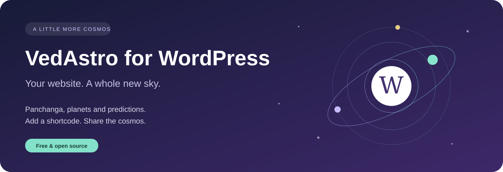
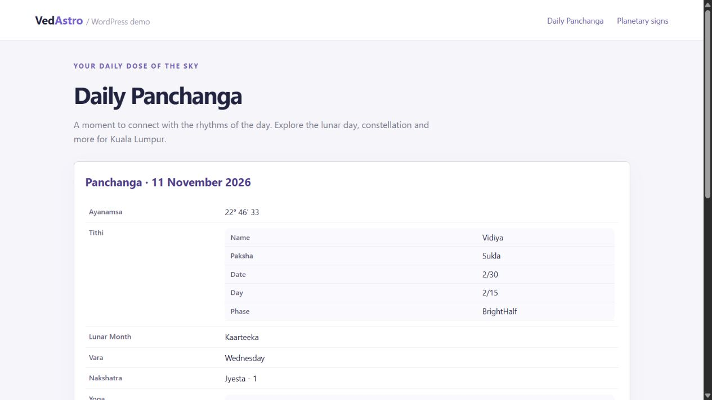
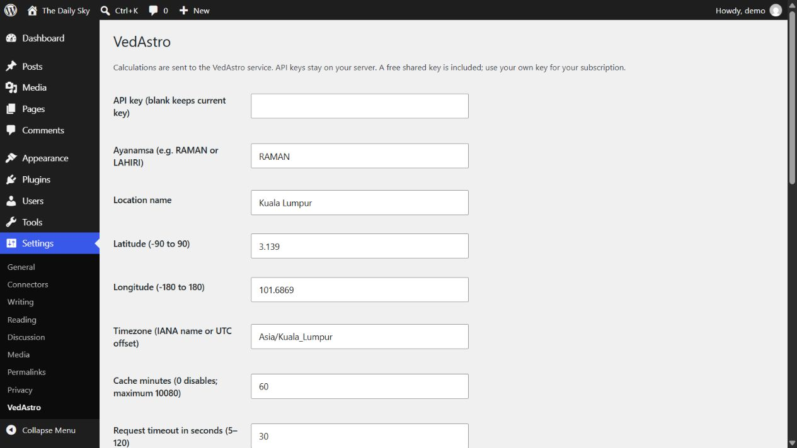
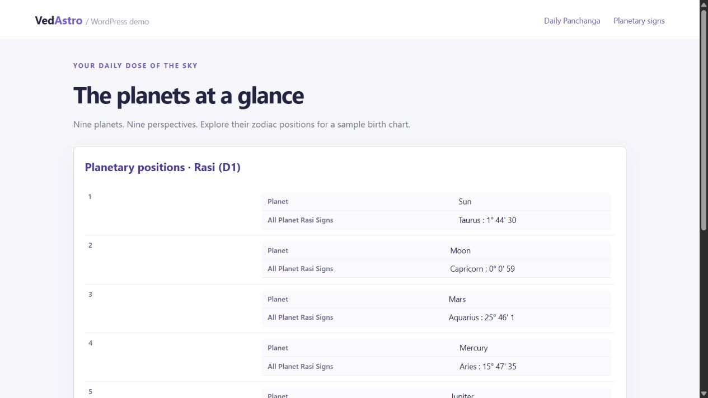

<p align="center"></p>

<p align="center">
  <a href="https://github.com/VedAstro/VedAstro.WordPress/releases/latest/download/vedastro.zip"><strong>↓ Download the plugin</strong></a> &nbsp; · &nbsp;
  <a href="https://vedastro.org/WordPressPlugin.html">Explore the plugin</a> &nbsp; · &nbsp;
  <a href="docs/REFERENCE.md">Shortcode reference</a>
</p>

<p align="center">WordPress 6.0+ &nbsp; · &nbsp; PHP 7.4+ &nbsp; · &nbsp; Free &amp; open source</p>

Bring Vedic astrology to your corner of the web. Add a daily Panchanga, planetary positions or birth-chart predictions to a WordPress page with a shortcode. Set your location once, then make it your own.

## See it in WordPress



*Real plugin output with live VedAstro calculations, shown in a sample WordPress theme. Your theme controls the surrounding page design.*

<table>
<tr><th>Follow the day</th><th>Explore a birth chart</th><th>Look a little deeper</th></tr>
<tr><td>Tithi, Nakshatra, Yoga, Karana, sunrise and sunset.</td><td>Planetary positions, house signs and horoscope predictions.</td><td>Dasa periods, compatibility and more calculation methods.</td></tr>
</table>

## Your first page, in three steps

### 1. Install

[Download **vedastro.zip**](https://github.com/VedAstro/VedAstro.WordPress/releases/latest/download/vedastro.zip). In WordPress, open **Plugins → Add New → Upload Plugin**, upload the ZIP and activate **VedAstro**.

### 2. Make it local

Open **Settings → VedAstro**. Choose your location, coordinates and timezone, then save. A shared free API key is included for trying the plugin. Use your own key for your subscription; service limits apply.

### 3. Add a little cosmos

Add a **Shortcode** block to a post or page and paste:

```text
[vedastro_panchanga]
```

Preview your page. You now have Panchanga for the current hour at your chosen location.

<details>
<summary><strong>See the settings screen</strong></summary>



Your API key stays on your WordPress server. It is never displayed to visitors.

</details>

## What will you add?

| To show… | Paste this into a Shortcode block |
| --- | --- |
| Daily Panchanga | `[vedastro_panchanga]` |
| Nine planetary signs | `[vedastro_planets date="1990-05-15 10:30"]` |
| Twelve house signs | `[vedastro_houses date="1990-05-15 10:30"]` |
| Birth-chart predictions | `[vedastro_horoscope date="1990-05-15 10:30"]` |
| Details for one planet | `[vedastro_planet planet="Sun" date="1990-05-15 10:30"]` |
| Details for one house | `[vedastro_house house="House1" date="1990-05-15 10:30"]` |
| Current Dasa periods | `[vedastro_dasa date="1990-05-15 10:30"]` |

Use **YYYY-MM-DD HH:MM** for birth dates in your configured timezone. Replace the sample date with the date you need. Omit `date` for the current hour. You can also choose a title, location or ayanamsa for each shortcode.

<details>
<summary><strong>See planetary positions on a WordPress page</strong></summary>



</details>

### Compare two birth charts

```text
[vedastro_compatibility date="1990-05-15 10:30" partner_date="1992-07-20 14:00"]
```

The API uses `date` for the male birth time and `partner_date` for the female birth time. If the birth locations differ, set the second person's `partner_location`, `partner_latitude`, `partner_longitude` and `partner_timezone`. [See the complete example →](docs/REFERENCE.md#shortcodes)

## A few useful things to know

**Can I try it for free?** Yes. The shared key is included, and the free tier allows five API requests per minute. The plugin is free; API subscription limits apply. [Manage your API key](https://vedastro.org/Account.html).

**Will it work with my theme?** Results appear within your existing page or post. The screenshots above use a sample theme; your site's fonts and surrounding layout may differ.

**How fresh are the results?** Successful results are reused for 60 minutes by default. Change this in Settings. Current-time calculations use the current hour; your site's page cache may also affect refresh times.

**How do I update?** Download the latest ZIP, upload it through WordPress, and choose the replacement option.

**What happens to birth details?** Supplied dates, locations and calculation inputs are sent to VedAstro to calculate results. Details written into public posts and their results are public. [Privacy policy](https://vedastro.org/PrivacyPolicy.html).

**Replacing the older plugin?** Use `vedastro_horoscope` with `date="YYYY-MM-DD HH:MM"` in place of `horoscope_predictions` and `timeurl`, then configure Settings → VedAstro.

## Go further

- [Full shortcode and configuration reference](docs/REFERENCE.md) — location overrides, ayanamsa, compatibility, JSON output and other API methods.
- [API Builder](https://vedastro.org/APIBuilder.html) — explore more calculations.
- [Developer guide](docs/REFERENCE.md#releases-and-development) — PHP usage, local checks and release packaging.
- [Get help or report a problem](https://github.com/VedAstro/VedAstro.WordPress/issues) — remove private birth details and API keys before sharing an example.

GPL-2.0-or-later · Made by [VedAstro](https://vedastro.org).
