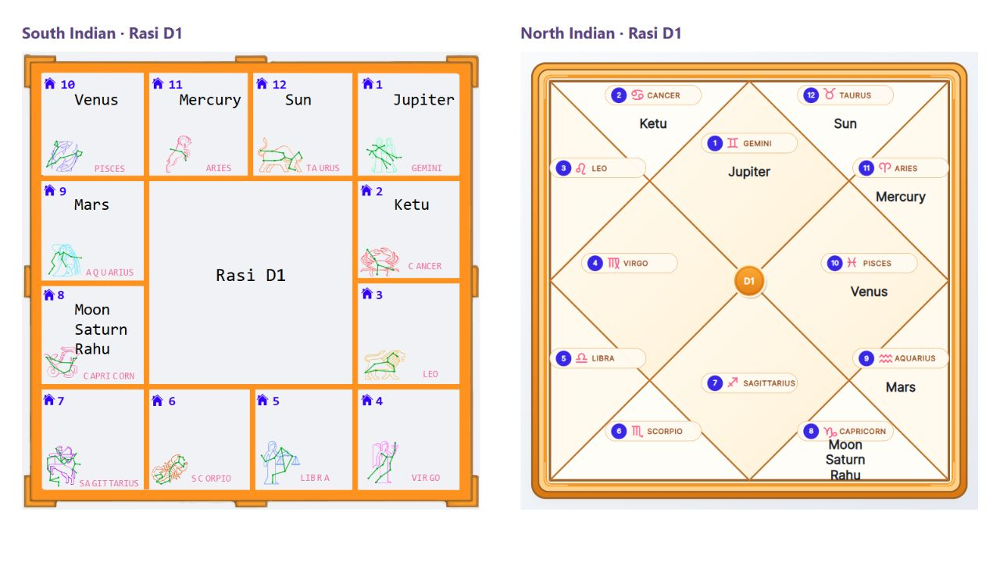
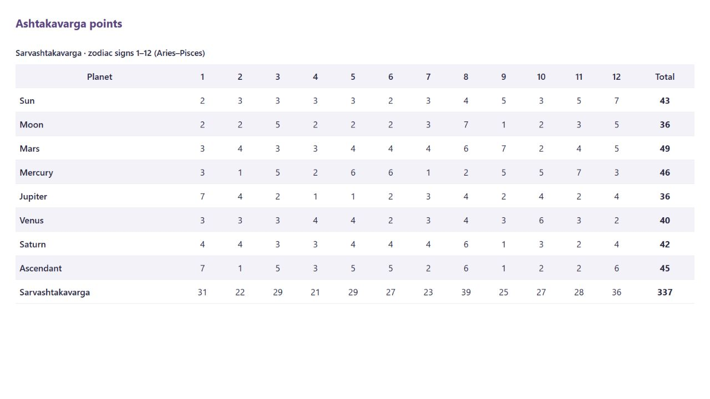

# WordPress plugin reference

Add Vedic astrology calculations to WordPress posts and pages with shortcodes. This is a fresh, standalone plugin built on the same JSON API as [VedAstro's Python client](https://github.com/VedAstro/VedAstro.Python). No Composer, JavaScript framework, database tables, or browser API keys.

## Install

1. [Download vedastro.zip from the latest release](https://github.com/VedAstro/VedAstro.WordPress/releases/latest/download/vedastro.zip).
2. In WordPress, open **Plugins → Add New → Upload Plugin**, select the ZIP, and activate **VedAstro**.
3. Open **Settings → VedAstro**. Set the location, coordinates, timezone and optional subscription API key. The shared `FreeAPIUser` key is the default; service subscription limits still apply.
4. Add a **Shortcode** block to a page and paste an example below.

Requires WordPress 6.0+ and PHP 7.4+. HTTPS access to `vedastro.zaishi.net` must be available from the WordPress server. This plugin is distributed through GitHub, not the WordPress.org directory.

WP-CLI installation:

```sh
wp plugin install https://github.com/VedAstro/VedAstro.WordPress/releases/latest/download/vedastro.zip --activate
```

## Shortcodes

```text
[vedastro_chart style="south" chart="RasiD1" date="1990-05-15 10:30"]
[vedastro_chart style="north" chart="NavamshaD9" date="1990-05-15 10:30"]
[vedastro_ashtakavarga date="1990-05-15 10:30"]
[vedastro_panchanga]
[vedastro_planets date="1990-05-15 10:30"]
[vedastro_houses date="1990-05-15 10:30"]
[vedastro_horoscope date="1990-05-15 10:30"]
[vedastro_planet planet="Sun" date="1990-05-15 10:30"]
[vedastro_house house="House1" date="1990-05-15 10:30"]
[vedastro_dasa date="1990-05-15 10:30" system="Vimshottari" depth="3"]
[vedastro_compatibility date="1990-05-15 10:30" partner_date="1992-07-20 14:00" partner_location="Mumbai" partner_latitude="19.076" partner_longitude="72.8777" partner_timezone="Asia/Kolkata"]
```

| Shortcode | Result |
| --- | --- |
| `vedastro_chart` | North or South Indian birth chart; Rasi, Navamsha and other supported divisional charts |
| `vedastro_ashtakavarga` | Sarvashtakavarga and Bhinnashtakavarga tables with twelve sign columns and totals |
| `vedastro_panchanga` | Bundled Panchanga, including Tithi, Nakshatra, Yoga, Karana, weekday, sunrise and sunset (one API request) |
| `vedastro_planets` | Rasi signs of all nine planets |
| `vedastro_houses` | Bhava Chalit signs of all twelve houses |
| `vedastro_horoscope` | Horoscope predictions for the supplied birth time |
| `vedastro_planet` | All available data for one planet |
| `vedastro_house` | All available data for one house |
| `vedastro_dasa` | Dasa periods active now for the supplied birth time; optional `at="2026-11-11 12:00"` |
| `vedastro_compatibility` | Match report; `date` is male birth time and `partner_date` is female birth time, matching the API contract |
| `vedastro` | Any Calculate endpoint with JSON parameters |

All preset shortcodes accept `date`, `location`, `latitude`, `longitude`, `timezone`, `ayanamsa` and `title`. The general data shortcodes also accept `format="json"`; `vedastro_chart` and `vedastro_ashtakavarga` always render their visual output. Dates use **YYYY-MM-DD HH:MM** in the selected timezone. Omit `date` for the current hour. Natal calculations should use an explicit birth date; birth charts, Ashtakavarga, Dasa and compatibility require one. A timezone such as `America/New_York` applies the UTC offset for the supplied date. Ambiguous repeated times during a daylight-saving transition should use an explicit offset such as `-05:00`.

Compatibility accepts independent `partner_location`, `partner_latitude`, `partner_longitude`, and `partner_timezone`; omitted partner location settings inherit the first person's settings. Set all four when the birth locations differ. Supported planet names include Sun, Moon, Mars, Mercury, Jupiter, Venus, Saturn, Rahu and Ketu; houses use House1 through House12. Ayanamsa names are the API enum names, e.g. RAMAN or LAHIRI.

## North and South Indian birth charts



```text
[vedastro_chart style="south" chart="RasiD1" date="1990-05-15 10:30"]
[vedastro_chart style="north" chart="RasiD1" date="1990-05-15 10:30"]
[vedastro_chart style="south" chart="NavamshaD9" date="1990-05-15 10:30" title="My Navamsha chart"]
```

| Attribute | Default | Meaning |
| --- | --- | --- |
| `date` | Required | Birth date and time, `YYYY-MM-DD HH:MM`, in the selected timezone |
| `style` | `south` | `south` for South Indian layout or `north` for North Indian layout |
| `chart` | `RasiD1` | Exact chart type from the table below |
| `title` | `Birth chart` | Heading above the chart |
| `location`, `latitude`, `longitude`, `timezone`, `ayanamsa` | Saved settings | Override the calculation defaults for this widget |

### Supported chart types

| Chart | `chart` value |
| --- | --- |
| Bhava Chalit | `BhavaChalit` |
| Rasi D1 | `RasiD1` |
| Hora D2 | `HoraD2` |
| Drekkana D3 | `DrekkanaD3` |
| Chaturthamsha D4 | `ChaturthamshaD4` |
| Saptamsha D7 | `SaptamshaD7` |
| Navamsha D9 | `NavamshaD9` |
| Dashamamsha D10 | `DashamamshaD10` |
| Dwadashamsha D12 | `DwadashamshaD12` |
| Shodashamsha D16 | `ShodashamshaD16` |
| Vimshamsha D20 | `VimshamshaD20` |
| Chaturvimshamsha D24 | `ChaturvimshamshaD24` |
| Bhamsha D27 | `BhamshaD27` |
| Trimshamsha D30 | `TrimshamshaD30` |
| Khavedamsha D40 | `KhavedamshaD40` |
| Akshavedamsha D45 | `AkshavedamshaD45` |
| Shashtyamsha D60 | `ShashtyamshaD60` |

Each chart makes one API request on a cache miss. Add two Shortcode blocks to display Rasi and Navamsha together. Charts resize to their container. They are embedded as SVG images, never active inline markup. If your site sets a Content Security Policy, its `img-src` directive must permit `data:` images. These widgets do not support `format="json"` or enclosed JSON parameters.

## Ashtakavarga tables



```text
[vedastro_ashtakavarga date="1990-05-15 10:30"]
[vedastro_ashtakavarga table="sarva" date="1990-05-15 10:30" title="Sarvashtakavarga points"]
[vedastro_ashtakavarga table="bhinna" date="1990-05-15 10:30"]
```

| Attribute | Default | Meaning |
| --- | --- | --- |
| `date` | Required | Birth date and time, `YYYY-MM-DD HH:MM` |
| `table` | `both` | `both`, `sarva` (Sarvashtakavarga), or `bhinna` (Bhinnashtakavarga) |
| `title` | `Ashtakavarga` | Heading above the tables |
| `location`, `latitude`, `longitude`, `timezone`, `ayanamsa` | Saved settings | Override calculation defaults for this widget |

Columns 1–12 represent zodiac signs **Aries through Pisces**, not houses. Row values and totals come from the API. The Sarvashtakavarga table includes the combined Sarvashtakavarga row; Bhinnashtakavarga lists the seven classical planets. Tables scroll horizontally on narrow screens using a keyboard-focusable region.

`table="both"` makes two API requests on a cache miss, one per table. Choosing `sarva` or `bhinna` makes one. These widgets always render tables; `format="json"` and enclosed JSON parameters do not apply.

## Other endpoints

Use the [API Builder](https://vedastro.org/APIBuilder.html) to find calculation method names and parameter names. The generic shortcode accepts any Calculate method name, never a URL. Enclosed content must be a JSON object with straight quotes. WordPress Shortcode blocks preserve these examples best.

```text
[vedastro endpoint="AllPlanetNavamshaSign" date="1990-05-15 10:30"]

[vedastro endpoint="PlanetRasiD1Sign" date="1990-05-15 10:30"]{"planetName":"Sun"}[/vedastro]

[vedastro endpoint="HoroscopePredictions" time_param="birthTime" date="1990-05-15 10:30"]{"filterTags":["RisingSign"],"sortByWeight":false}[/vedastro]
```

`time_param` chooses the parameter to receive the generated Time object (default `time`). Use `time_param="none"` for methods without a Time parameter, or supply full JSON Time objects for methods with multiple times. Explicit JSON time values take precedence. JSON must match the endpoint's exact parameter names and types. The generic interface does not promise that every API endpoint is fast enough for a web page.

Developers can call the same client from PHP after plugins load:

```php
$time = VedAstro_Plugin::time(array('date' => '1990-05-15 10:30'));
if (!is_wp_error($time)) {
    $result = VedAstro_Client::calculate('AllPlanetRasiSigns', array('time' => $time));
    // Returns the endpoint's payload or WP_Error. Escape values before output.
}
```

## Operation and privacy

- Requests go server-to-server to `https://vedastro.zaishi.net/api/Calculate/{method}` using POST JSON and the `x-api-key` header. Supplied birth dates, coordinates, parameters and the configured API key are sent to VedAstro only when a shortcode or PHP calculation runs on a cache miss. There is no background telemetry or visitor-facing calculation endpoint. The free tier currently allows five requests per minute; most presets make one request per cache miss; Ashtakavarga with `table="both"` makes two.
- Successful results are stored in WordPress transients for 60 minutes by default. Keys include the method, parameters, API key and ayanamsa. Failures are not cached. Set cache minutes to 0 to disable this cache. Current-time calculations use the current hour for reusable cache entries.
- Full-page caches can serve older output without running PHP. Configure their expiration to suit your content. Large all-data calculations may exceed the default 30-second request timeout; adjust it in Settings (5–120 seconds).
- Birth data written into a public post and its rendered results are public. Do not put confidential birth details into public shortcodes. Transient results live in the site's database or configured object cache until expiration. Uninstall removes plugin settings and its database transients on the current site. External object caches expire their entries normally.
- The Settings API restricts configuration to administrators and protects saves with WordPress nonces. Keys are never rendered in the settings form or returned in visitor errors. For configuration outside the database, define `VEDASTRO_API_KEY` in `wp-config.php`.
- The plugin escapes all API text, including prediction descriptions, and does not execute API HTML, scripts, or nested shortcodes; dedicated chart widgets display SVG only as inert images.
- [VedAstro privacy policy](https://vedastro.org/PrivacyPolicy.html) and [service website](https://vedastro.org) apply to external API use. No data requests occur merely by activating the plugin.

This replaces the old, incomplete `horoscope_predictions` plugin. Replace old shortcodes with the examples above; ISO `timeurl` values are no longer used. Settings are not automatically migrated.

## Releases and development

Every push to `main` runs PHP 7.4/8.4 contract tests, packages the plugin, installs and activates the ZIP in a real WordPress instance, and exercises all documented examples with deterministic HTTP fixtures. Only after these checks pass does GitHub Actions publish a release with `vedastro.zip`. The version is `1.0.<workflow run number>`, stamped into the ZIP's plugin header, constant and stable tag; source stays at the development version. Re-running a workflow replaces the same release asset.

The stable download address is:

```text
https://github.com/VedAstro/VedAstro.WordPress/releases/latest/download/vedastro.zip
```

Install updates by uploading the latest release ZIP and choosing WordPress's replacement option. There is no automatic updater or WordPress.org listing.

```sh
php tests/test.php
python scripts/build.py
```

The package contains one `vedastro/` directory and excludes tests, workflows, build scripts and repository metadata. Integration tests use mock responses to avoid depending on service uptime or consuming quota. To check the deployed API separately: `python scripts/smoke.py` checks four bundled endpoints using the shared key. Set `VEDASTRO_API_KEY` to a subscription key to check all nine endpoints, or pass specific method names (up to five per minute with the free key).

Report problems through [GitHub Issues](https://github.com/VedAstro/VedAstro.WordPress/issues). Include the shortcode with private birth information and keys removed, WordPress/PHP versions and the visible error.

License: GPL-2.0-or-later.
